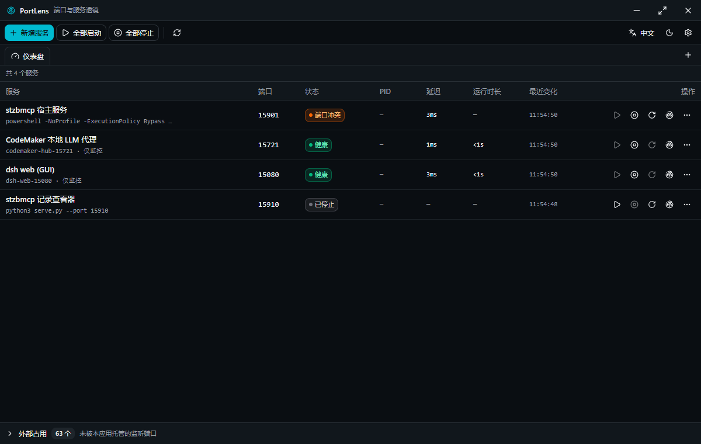

# PortLens

Windows 桌面端口服务工具：按端口看服务状态、看健康、启停自己配置的服务、在应用内多标签浏览服务页面。

Tauri 2（Rust 后端 + WebView2 前端）+ React 19 + shadcn/ui（Tailwind v4）。

## 功能

- **指定端口监听**：清单里声明的端口持续轮询，显示是否在听、占用 PID / 进程 / exe、连接数、响应延迟。
- **健康状态**：每个端口可配 `tcp` / `http` / `exec` / `none` 探针，状态机给出 未启动 / 启动中 / 健康 / 降级 / 崩溃 / 被外部占用 / 未知，并保留最近 120 次探针结果画时间线。
- **启停**：每个服务可配「名称 + 端口 + 启动命令 + 工作目录」，一键 启动 / 停止 / 重启；停止按进程树处理（先 `taskkill /T`，超时再 `/F`）。
- **外部占用**：不是本工具拉起的监听端口也一并列出，二次确认后可停止（可选强制结束进程树）。
- **外部服务的日志**：Windows 没有事后接管别人 stdout 的 API，所以外部服务用**日志文件跟踪** —— 清单里给服务配 `logSource: { type: "file", path: "logs\\app-*.log", encoding: "gbk" }`，PortLens 增量跟随该文件（含通配最新的轮转日志、截断重置、UTF-8/GBK/UTF-16 等编码），行走进同一个日志面板与事件流。详见 [docs/manifest.md](docs/manifest.md#日志来源外部服务为什么需要它)。
- **应用内多标签页面浏览**：每个标签一个真实子 WebView（不是 iframe），可开多个服务页面、切标签、改地址、刷新、关闭；标签与窗口尺寸会记住。
- **端口风险告警**：端口落在 Windows 动态端口段或 winnat/Hyper-V 排除段时给出徽标（这类端口可能被抢占，`listen` 报 EACCES）。

## 截图



（导入 `presets/workspace-gm10.json` 后的仪表盘：健康 / 降级 / 端口冲突 / 已停止 四种状态，底部是外部占用计数。）

## 环境要求

- Windows 10 1809+（WebView2）
- Rust **1.97.0**（`src-tauri/rust-toolchain.toml` 固定；1.98 stable 编 `windows` 0.61.x 会崩）
- Node.js ≥ 18 + pnpm

本仓库用**工作区本地工具链**（`E:\Workspace\.cargo` / `.rustup`），不依赖系统 Rust。所有入口都会先激活它。

## 构建与运行

```powershell
make ports              # 运行 release exe（无 HTTP 服务，前端已内嵌）
make ports-build        # 构建 release exe（前端打包 + cargo build --release，不含安装包）
make ports-dev          # 开发模式（Vite dev server 15273 + tauri dev，热更新）
make ports-package      # 打包 Windows 安装包（NSIS，产物在 src-tauri\target\release\bundle\nsis）
```

等价的直接调用（`env\tauri-app.ps1` 是通用入口，dot-source `env\activate-rust.ps1` 复用本地工具链）：

```powershell
powershell -NoProfile -ExecutionPolicy Bypass -File E:\Workspace\env\tauri-app.ps1 -App submodules/PortLens -Action build
```

## 测试

```powershell
cd src-tauri; cargo test                        # 单测（56）+ 真实进程集成测试（2）
cd ..; pnpm test                                # 前端纯逻辑（node --test "tools/*.test.mjs"）
node tools/e2e-ports.mjs                        # CDP E2E：服务生命周期 + 外部占用 + HTTP 探针
node tools/e2e-pages.mjs                        # CDP E2E：多标签页面浏览
node tools/e2e-logs.mjs                         # CDP E2E：外部进程的日志文件实时跟随
node tools/smoke-release.mjs                    # 打包 exe 冒烟（真实 CSP + 真实进程）
```

E2E 与冒烟脚本会自己拉起 `src-tauri\target\release\PortLens.exe`（先 `make ports-build`），
并在 `tmp\e2e-*` 下用独立的 `PORTLENS_DATA_DIR` 跑，不会碰你的真实清单。
手工调试单条表达式：`powershell -NoProfile -File tools\cdp.ps1 -Expr "document.title"`。

## 数据位置

| 文件 | 内容 |
|---|---|
| `%LOCALAPPDATA%\PortLens\services.json` | 服务清单（`--config <path>` 或 `PORTLENS_CONFIG` 可覆盖） |
| `%LOCALAPPDATA%\PortLens\ui.json` | 窗口尺寸位置 + 页面标签 |
| `%LOCALAPPDATA%\PortLens\runtime.json` | 运行时台账（本工具拉起过的 PID + 创建时间，用于重启后认领） |

清单格式见 [docs/manifest.md](docs/manifest.md)，页面标签机制见 [docs/pages.md](docs/pages.md)。

## 架构

| 层 | 源文件 |
|---|---|
| TCP 监听表（GetExtendedTcpTable） | `src-tauri/src/ports.rs` |
| 进程信息 / 进程树停止 | `src-tauri/src/proc.rs` |
| 动态端口段与排除段诊断 | `src-tauri/src/netsh.rs` |
| 健康探针（tcp / http / exec） | `src-tauri/src/probe.rs` |
| 状态机 + 历史 | `src-tauri/src/health.rs` |
| 日志文件 tail-follow（外部服务日志） | `src-tauri/src/tail.rs` |
| 服务进程托管 + 台账 | `src-tauri/src/supervise.rs` |
| 日志环形缓冲 | `src-tauri/src/logs.rs` |
| 轮询线程与事件 | `src-tauri/src/monitor.rs` |
| 子 WebView 页面标签 | `src-tauri/src/pages.rs` |
| 清单与路径 | `src-tauri/src/config.rs` |
| Tauri 命令 | `src-tauri/src/state.rs` |
| 窗口尺寸记忆 | `src-tauri/src/window_state.rs` |
| 前端（表格 / 抽屉 / 对话框 / 标签条） | `src/` |

## 已知限制

- 仅 Windows；只处理 TCP 端口（UDP 不在范围）。
- 停止非本工具启动的提权进程会报 `ACCESS_DENIED`，需以管理员身份运行本工具；v1 不做自动提权。
- Windows 没有 SIGTERM 语义：优雅停止 = 自定义命令（无）+ `taskkill /T`（不带 `/F`）+ 3 秒宽限，控制台程序可能被直接硬停。
- 外部进程只显示 exe 路径与父进程，不显示命令行（读远端 PEB 代价大）。
- **外部进程的 stdout 抓不到**（Windows 没有事后接管 stdio 的 API，控制台缓冲区对 ConPTY / 重定向进程无效）；
  要看外部服务日志请配 `logSource` 文件跟踪，或用「停止后由本工具重启」的方式让它变成托管进程。
- `http` 探针是手写明文 HTTP，不支持 TLS：https 服务请改用 `tcp` 探针。
- 子 WebView 不抓网页标题、不注入 IPC；页面标题默认是服务名或 host:port，可在标签上双击重命名。
- 图标暂时复用 LogLens 的图标资源作占位。
